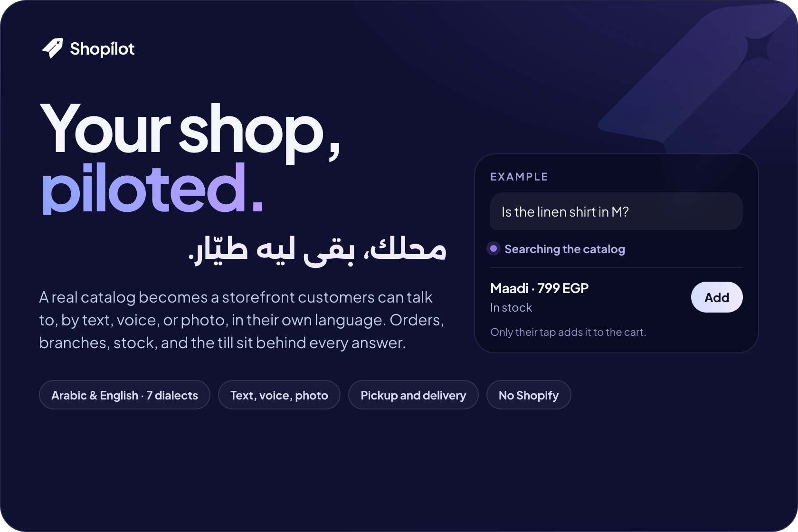
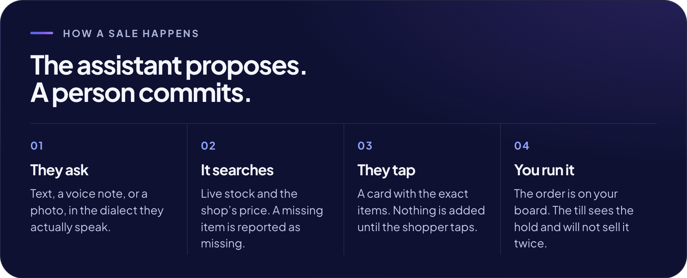
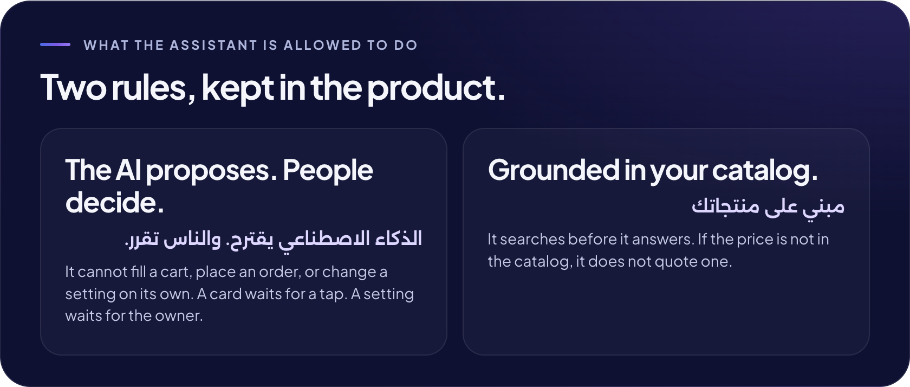
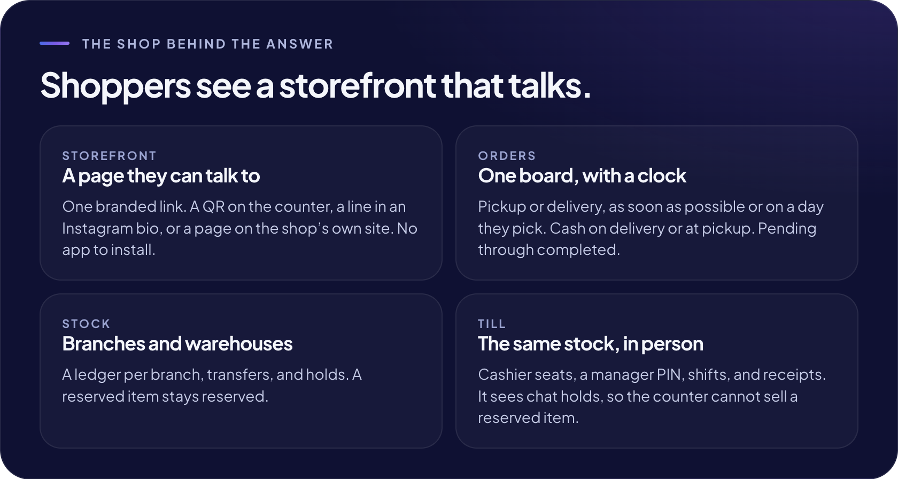
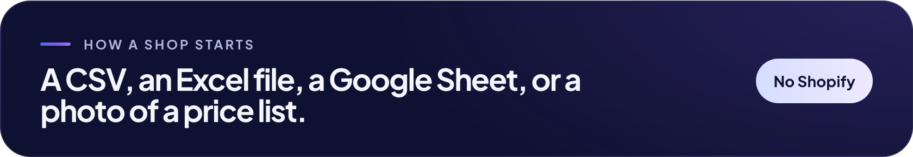

  

  <a href="https://shopilot.store">shopilot.store</a>
  &nbsp;&nbsp;·&nbsp;&nbsp;
  <a href="mailto:accounts@shopilot.store">accounts@shopilot.store</a>

  

  

  

  

  Shopilot for Information Technology L.L.C · Cairo 
  <a href="https://shopilot.store/privacy.html">Privacy</a>
  &nbsp;&nbsp;·&nbsp;&nbsp;
  <a href="https://shopilot.store/terms.html">Terms</a>

