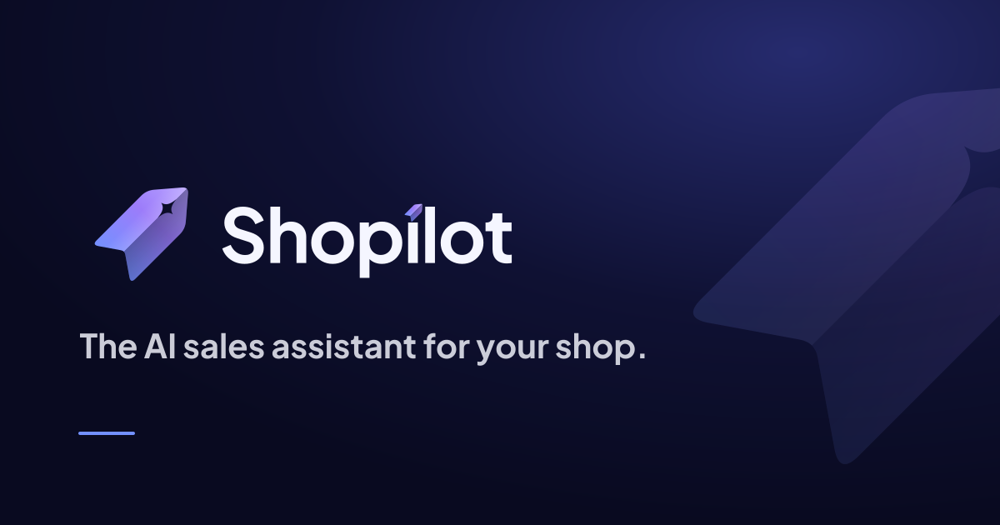

  

  <a href="https://shopilot.store">shopilot.store</a>
  &nbsp;&nbsp;·&nbsp;&nbsp;
  <a href="mailto:accounts@shopilot.store">accounts@shopilot.store</a>

Early access · onboarding retailers in Egypt.

<b>شوبايلوت</b> مساعد بيع بالذكاء الاصطناعي ونظام إدارة للمتاجر في مصر. الإجابة من مخزون المتجر وأسعاره، ولا يتم الطلب إلا بعد تأكيد الشخص.

A shop brings its catalog as a CSV, an Excel file, a Google Sheet, or a photo of a price list. No Shopify.

That catalog becomes a public storefront, a back office, a till, and an assistant. The assistant sells from the shop's live stock and prices, in the language the customer used.

## The sale

The customer opens the shop's link: a QR on the counter, a line in an Instagram bio, or a page on the shop's own site. They write, speak, or send a photo of the product.

The assistant answers in Arabic, English, French, or Turkish, in the dialect the customer used. The price and the branch come from the shop's data. When the product is missing, the assistant says so and names the closest item that is in stock.

It shows a basket. The customer taps to reserve it for pickup, delivery, or cash on delivery. Stock is held for 48 hours. The order lands in the dashboard, the merchant approves it, and the customer can follow it.

## The shop

**Storefront.** One branded page per shop, with the assistant on it.

**Back office.** Branches and warehouses, the catalog, inventory and transfers, orders, leads, staff, reviews, loyalty, and analytics.

**Till.** The same stock, sold at the counter. Shifts, receipts, and a manager approval when the sale needs one.

**Shopper app.** The merchant's customers find the shop, ask, and follow an order.

## Company

[Shopilot for Information Technology L.L.C](https://shopilot.store) · Cairo

[Privacy](https://shopilot.store/privacy.html) · [Terms](https://shopilot.store/terms.html)
